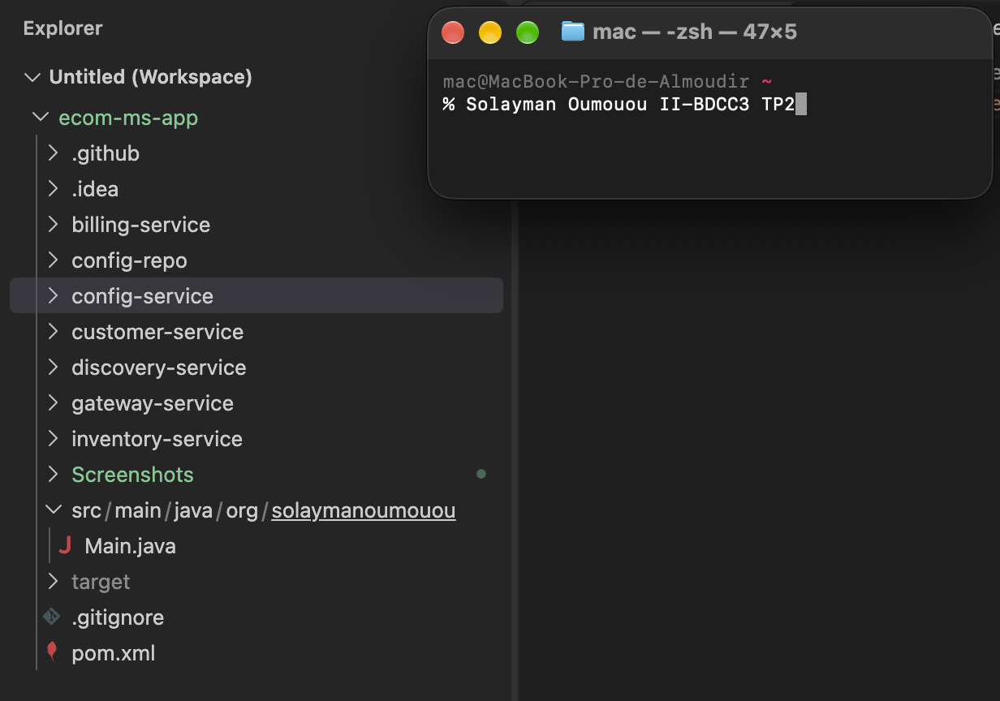
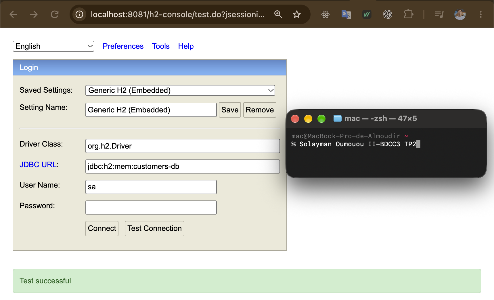
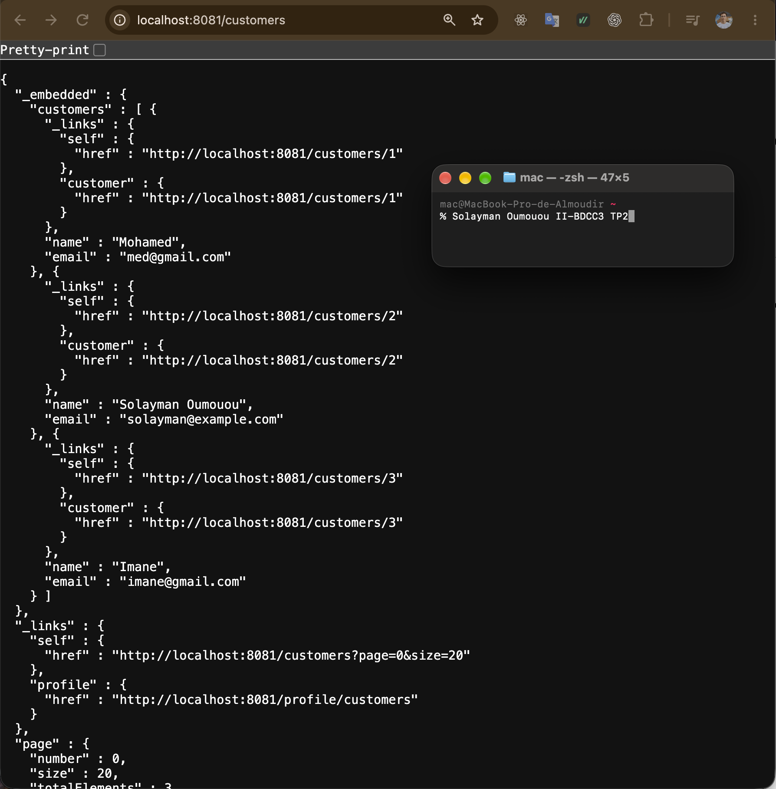
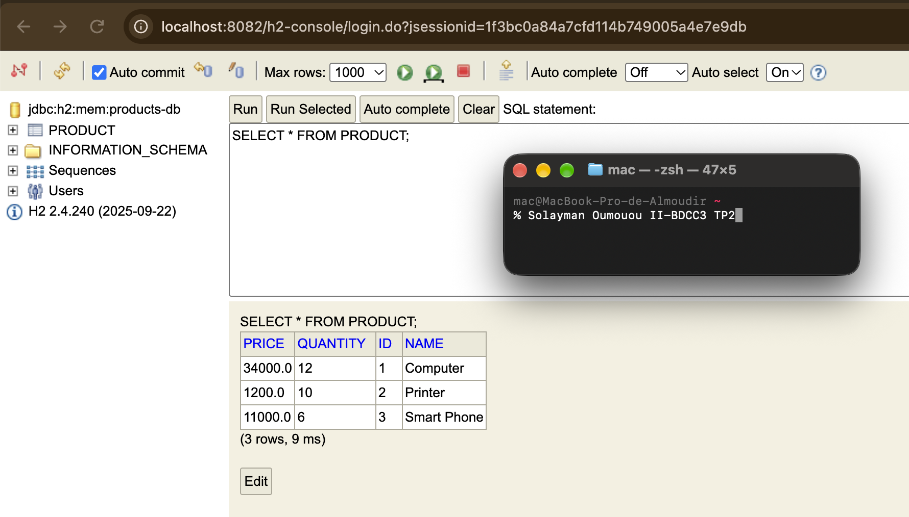
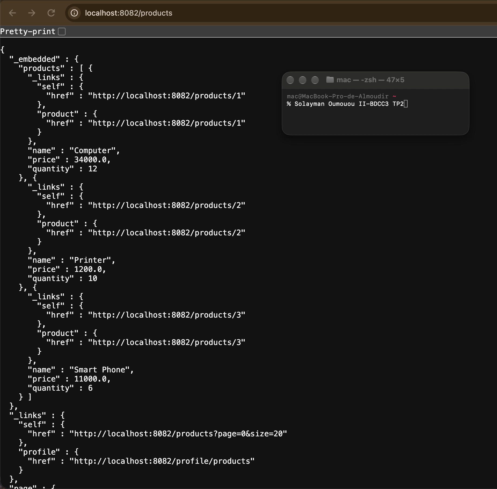

# TP 2 – Application e-commerce

**Solayman Oumouou – II-BDCC3**

## Structure du projet

Le projet `ecom-ms-app` est organisé en six microservices. La capture montre leurs dossiers et le dossier `config-repo`.

## Service clients

J’ai testé la connexion à la base H2 `customers-db` depuis la console du service sur le port `8081`. La console affiche le message « Test successful ».

J’ai ensuite ouvert `http://localhost:8081/customers` dans le navigateur. La réponse JSON contient trois clients, avec leur nom et leur adresse e-mail.

## Service inventaire

Dans la console H2 du service sur le port `8082`, j’ai exécuté la requête `SELECT * FROM PRODUCT;` sur la base `products-db`. Le résultat contient trois produits avec leur prix et leur quantité en stock.

J’ai retrouvé les mêmes produits au format JSON en ouvrant `http://localhost:8082/products`.

